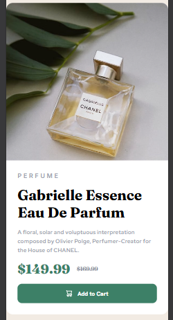

# Frontend Mentor - Product preview card component solution

This is a solution to the [Product preview card component challenge on Frontend Mentor](https://www.frontendmentor.io/challenges/product-preview-card-component-GO7UmttRfa). Frontend Mentor challenges help you improve your coding skills by building realistic projects. 

## Table of contents

- [Overview](#overview)
  - [The challenge](#the-challenge)
  - [Screenshot](#screenshot)
  - [Links](#links)
- [My process](#my-process)
  - [Built with](#built-with)
  - [What I learned](#what-i-learned)
  - [Continued development](#continued-development)
  - [AI Collaboration](#ai-collaboration)
- [Author](#author)
- [Acknowledgments](#acknowledgments)

**Note: Delete this note and update the table of contents based on what sections you keep.**

## Overview

### The challenge

Users should be able to:

- View the optimal layout depending on their device's screen size
- See hover and focus states for interactive elements

d ### Screenshot
 

### Links

- Solution URL: [https://60secondbrocode-lang.github.io/product-preview-card-component/](https://your-solution-url.com)
- Live Site URL: [https://60secondbrocode-lang.github.io/product-preview-card-component/](https://your-live-site-url.com)

## My process

### Built with

- Semantic HTML5 markup
- CSS custom properties
- Flexbox

### What I learned

 how  using pseudo element along with flex effectively without the need  of  position absolute property , how a single slash from directory navigation can stop your image in github live and the last one is using flex wrap correctly.

### Continued development

 I will continue  to develop layout alignment and  debugging.

### AI Collaboration

I used mostly Gemini for researching , asking some definition of the property and guide..

## Author

- Website - [O Zai Par](https://www.your-site.com)
- Frontend Mentor - [https://www.frontendmentor.io/profile/60secondbrocode-lang )

## Acknowledgments
 I would love to thank to every single developer who made these challenges which make it easy to build a project.